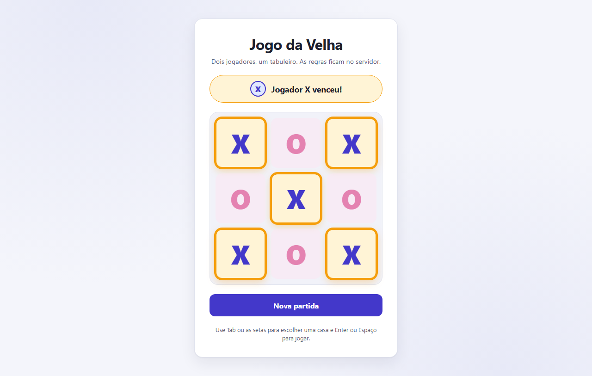

# Jogo da Velha — Delphi Berlin + Web

Projeto de estudo de **Spec-Driven Development (SDD)**: um Jogo da Velha para dois jogadores locais, com servidor HTTP em Delphi 10.1 Berlin (Indy) controlando as regras, interface em HTML/CSS/JS e testes end-to-end com Playwright + TypeScript.

| Documento | Conteúdo |
|---|---|
| [`docs/spec.md`](docs/spec.md) | Especificação: regras, critérios de aceitação, requisitos |
| [`docs/plan.md`](docs/plan.md) | Plano técnico: arquitetura, contrato HTTP, entregas |
| [`docs/test-plan.md`](docs/test-plan.md) | Plano de testes: cenários e critérios de aprovação |
| [`docs/delivery-log.md`](docs/delivery-log.md) | Registro de cada entrega: comandos, resultados e limitações |
| [`docs/spec-online.md`](docs/spec-online.md), [`docs/plan-online.md`](docs/plan-online.md), [`docs/test-plan-online.md`](docs/test-plan-online.md) | Especificação, plano e plano de testes do modo online |
| [`docs/checklist-publicacao-o8.md`](docs/checklist-publicacao-o8.md) | Checklist de publicação na internet (referência; a O8 foi cancelada) |

## Estado atual

- **Entrega 1 — Estrutura do servidor e `GET /health`:** concluída.
- **Entrega 2 — Motor do jogo (`uGameEngine`) e testes unitários (`EngineCheck`):** concluída.
- **Entrega 3 — Serviço de jogo (`uGameService`) e API HTTP:** concluída.
- **Entrega 4 — Testes da API com Playwright + TypeScript:** concluída.
<<<<<<< HEAD
- **Entrega 5 — Interface web e testes E2E no Chromium:** validada (109/109 testes), aguardando aprovação.
- Próximas: Entrega 6 (documentação final) e Entrega 7 (validação final).
- **Modo online (em desenvolvimento, `docs/plan-online.md`):** O0 a O7 aprovadas; o modo online termina na O7 (validação final na rede local, com o roteiro manual parcial). **Projeto de estudo: não será publicado na internet**; a O8 foi cancelada e [`docs/checklist-publicacao-o8.md`](docs/checklist-publicacao-o8.md) fica só como referência.
=======
- **Entrega 5 — Interface web e testes E2E no Chromium:** validada (109/109 testes), concluída.
>>>>>>> 5bad30a4cdc40348eb1e39b40e7c21c745e8cfb5



## Como este projeto foi feito com SDD

Nenhuma linha de código foi escrita antes de existir uma especificação aprovada. O ciclo foi:

1. **Especificação** ([`docs/spec.md`](docs/spec.md)): regras numeradas (RN), comportamentos de interface (CI), critérios de aceitação objetivos (CA), requisitos não funcionais (RNF) e dúvidas registradas (D). Toda mudança de requisito entra no histórico de versões do documento.
2. **Plano técnico** ([`docs/plan.md`](docs/plan.md)): decisões técnicas numeradas (DT), contrato HTTP exato e a divisão em entregas pequenas.
3. **Plano de testes** ([`docs/test-plan.md`](docs/test-plan.md)): cada CA ligado a testes em uma matriz de rastreabilidade, por camada (motor, serviço, API, interface).
4. **Implementação por entrega**, uma de cada vez e com aprovação humana entre elas:
   - **fase vermelha**: os testes são escritos e executados *antes* do código, e precisam falhar;
   - **fase verde**: implementação até os testes passarem;
   - **sabotagem** (SB-01 a SB-06): defeitos são inseridos de propósito em cópias do código, e os testes precisam detectá-los — prova de que não passam por acaso.
5. **Validação real**: um script por entrega (`scripts\validate-stepN.cmd`) compila, executa e registra tudo em log. Nenhum resultado é declarado sem execução; os números e os defeitos encontrados estão em [`docs/delivery-log.md`](docs/delivery-log.md).

Princípio central: **toda regra de negócio vive no backend Delphi**. O JavaScript só exibe o estado que o servidor devolve, e a SB-06 prova que a interface não decide nada sozinha.

## Requisitos

- Windows (Win32).
- Delphi 10.1 Berlin, edição Professional ou superior (a Starter não tem o compilador de linha de comando `dcc32`).
- Windows PowerShell 5.1 e `curl.exe` (já vêm no Windows 10/11), apenas para os scripts de validação.
- Node.js 22, 24 ou 26 para os testes Playwright (testado com 24.11.1). Nada é instalado globalmente: as dependências ficam em `tests\node_modules`.

## Compilar

### Linha de comando

```bat
scripts\build.cmd
```

O script carrega `rsvars.bat` de `C:\Program Files (x86)\Embarcadero\Studio\18.0\bin`. Se o Delphi estiver em outro lugar:

```bat
set "DELPHI_RSVARS=D:\Caminho\Para\Studio\18.0\bin\rsvars.bat"
scripts\build.cmd
```

Saída: `server\bin\TicTacToeServer.exe` e `server\bin\EngineCheck.exe`.

### IDE

1. *File > Open Project* e escolha `server\TicTacToeServer.dpr` (a IDE cria o `.dproj`).
2. Em *Project > Options > Delphi Compiler*, defina *Output directory* = `bin` e *Unit output directory* = `dcu`.
3. Plataforma Win32, *Build*.

## Executar

```bat
server\bin\TicTacToeServer.exe
server\bin\TicTacToeServer.exe --port 9000
server\bin\TicTacToeServer.exe --www C:\outra\pasta\web
server\bin\TicTacToeServer.exe --bind 127.0.0.1
```

- **Jogar:** abra `http://127.0.0.1:8765/` no navegador. A interface (`web\index.html`, `style.css`, `app.js`) é servida pelo próprio servidor, lida do disco a cada requisição (por padrão, a pasta `web` do repositório).

- Endereço: `http://127.0.0.1:8765` (porta padrão 8765). Use sempre `127.0.0.1`, não `localhost`.
- **Endereço de escuta:** por padrão o servidor escuta em `0.0.0.0` (todas as interfaces IPv4), então também atende pela rede local, por exemplo pelo celular em `http://<IP do computador>:8765/`. O tráfego é HTTP sem criptografia: use só em rede confiável. Para aceitar conexões apenas deste computador, use `--bind 127.0.0.1`. `--bind` aceita um endereço IPv4 deste computador.
- Opções inválidas ou desconhecidas encerram o servidor com código 2 e mostram o uso.
- Encerrar: **Ctrl+C** na janela do servidor.
- Se a porta estiver em uso, o servidor avisa e sai com código 1.
- **Proteções (desde a O6, `docs/plan-online.md`, seção 13.1):** toda resposta traz `X-Content-Type-Options: nosniff` e `Referrer-Policy: no-referrer`, e as páginas, uma `Content-Security-Policy` que só permite o próprio endereço. Nenhum corpo de requisição ocupa mais de 64 KB de memória (acima disso, 413). Uma conexão que fica 30 s sem mandar nada antes de completar o pedido é fechada (`--http-timeout-seconds`). Acima de `--max-connections`, a resposta é 503 `SERVIDOR_OCUPADO`. No uso normal na rede local nada disso muda; a única diferença visível é que uma jogada local (`/api/game/moves`) com corpo acima de 64 KB recebe 413.
- **Limites por cliente** (desligados por padrão; ligados com `--public`): `--rate-create N`, `--rate-join N` e `--rate-ws N` (criações, consultas/entradas e aberturas de canal por minuto; acima, 429 com `Retry-After`), `--ws-per-client N` (canais abertos ao mesmo tempo) e `--ws-msg-rate N` (mensagens por canal a cada 10 s). O console mostra os limites em vigor ao iniciar.
- **Modo público (`--public`, preparação para a internet, ainda não publicado):** exige `--allowed-origin https://<domínio>` (só `https`), escuta em `127.0.0.1`, recusa o canal sem `Origin`, desativa `/api/game*` (404) e leva `/` à página online. Liga os limites por cliente (10 criações, 30 consultas/entradas e 30 aberturas de canal por minuto; 8 canais por cliente; 30 mensagens por canal a cada 10 s). Atrás de um proxy reverso, use também `--trust-proxy`, para que cada visitante conte como um cliente (pelo `X-Forwarded-For` que o proxy acrescenta). A publicação em si (domínio, HTTPS e proxy) é a Entrega O8.

Verificação de saúde:

```bat
curl.exe -i http://127.0.0.1:8765/health
```

Resposta esperada:

```http
HTTP/1.1 200 OK
Content-Type: application/json; charset=utf-8
Cache-Control: no-store

{"status":"ok"}
```

## API

| Método | Rota | Resposta |
|---|---|---|
| GET | `/api/game` | 200 + estado |
| POST | `/api/game/moves` com `{"posicao": 0-8}` | 200 + estado, 400 ou 409 |
| POST | `/api/game/reset` | 200 + estado inicial |
| GET | `/health` | 200 `{"status":"ok"}` |

Exemplo:

```bat
curl.exe -X POST -H "Content-Type: application/json" -d "{\"posicao\":4}" http://127.0.0.1:8765/api/game/moves
```

Contrato completo (formato do estado, códigos de erro): `docs/plan.md`, seção 3.

### Salas do modo online (em desenvolvimento)

A partir da Entrega O2, o servidor também tem as rotas REST das salas (`docs/plan-online.md`, seção 6), desde a O3 o canal em tempo real `/ws` e, desde a O4, a página `/online.html` (veja "Jogar online" abaixo).

| Método | Rota | Resposta |
|---|---|---|
| POST | `/api/rooms` | 201 + `{sala, jogador}` (X) e `Location` |
| GET, HEAD | `/api/rooms/{codigo}` | 200 + `{sala}` |
| POST | `/api/rooms/{codigo}/players` | 201 + `{sala, jogador}` (O); com o próprio token, 200 (reentrada) |
| POST | `/api/rooms/{codigo}/moves` com `{"posicao": 0-8}` | 200 + `{sala}` |
| POST | `/api/rooms/{codigo}/reset` | 200 + `{sala}` (nova partida, só com a partida encerrada) |
| POST | `/api/rooms/{codigo}/leave` | 200 + `{sala}` encerrada |

O token do jogador vai só no cabeçalho `Authorization: Bearer <token>`, nunca na URL; `moves`, `reset` e `leave` exigem o token. Exemplo:

```bat
curl.exe -i -X POST http://127.0.0.1:8765/api/rooms
curl.exe -X POST -H "Authorization: Bearer <token>" -H "Content-Type: application/json" -d "{\"posicao\":4}" http://127.0.0.1:8765/api/rooms/<CODIGO>/moves
```

**Canal em tempo real (`/ws`, desde a O3):** WebSocket na mesma porta (`ws://<endereço>:8765/ws`). Depois de abrir, o cliente envia `{"tipo":"entrar","protocolo":1,"sala":"<CODIGO>","token":"<token>"}` em até 5 s e passa a receber `bem_vindo` e um `estado` a cada mudança da sala; `{"tipo":"ping","id":N}` recebe `pong`. As jogadas continuam pelo REST; o canal só notifica. Protocolo completo: `docs/plan-online.md`, seção 7.

**Origem (`Origin`):** a abertura do canal e os `POST` de sala só são aceitos sem `Origin` ou com uma origem da lista permitida (`docs/plan-online.md`, seção 7.7); o `Host` não é usado. A lista aparece no console ao iniciar (`Origens permitidas: ...`): no modo padrão, `http://127.0.0.1:<porta>`, `http://localhost:<porta>` e o IP privado de cada interface da rede local. Para abrir pelo nome do computador, acrescente `--allowed-origin http://<nome>:<porta>` (vários valores separados por vírgula ou com a opção repetida). Com `--public`, só valem as origens `https` informadas em `--allowed-origin` (pelo menos uma), e o canal sem `Origin` é recusado. A origem não substitui o token: as ações sobre a sala sempre exigem o token do jogador.

Opções do canal: `--ws-hello-seconds N` (prazo para o `entrar`, 1 a 300, padrão 5) e `--ws-idle-seconds N` (canal sem mensagens recebidas, 2 a 3600, padrão 60).

Opções de salas: `--max-rooms N` (salas abertas, padrão 500), `--max-connections N` (padrão 256), `--remember-seconds N`, `--room-ttl-seconds N` e `--sweep-ms N` (os dois últimos passam a ter efeito com o encerramento de salas abandonadas, numa entrega futura).

## Jogar online (duas pessoas, dois navegadores)

A página `/online.html` (link "Jogar online" na página local) cria uma sala, mostra o código e o link para compartilhar e sincroniza as jogadas em tempo real. O servidor continua sendo a autoridade: a página só envia as jogadas e desenha o estado que o servidor devolve.

**Na rede local (computador + celular, ou dois computadores):**

1. Inicie o servidor sem opções (escuta em `0.0.0.0`): `server\bin\TicTacToeServer.exe`. O console mostra a linha `Origens permitidas: http://127.0.0.1:8765, http://localhost:8765, http://<IP>:8765` com o IP do computador na rede.
2. Na primeira vez, o Firewall do Windows pode perguntar se o `TicTacToeServer.exe` pode receber conexões: permita em **Redes privadas**. A rede do computador precisa estar como rede **privada**. *(O7: o comportamento com o firewall ligado não foi testado; neste computador, em 20/10, o firewall estava desligado nos perfis Privado e Público e a rede cabeada estava como Pública. Roteiro em `docs/test-plan-online.md`, MV-L14.)*
3. No computador, abra `http://<IP>:8765/online.html` (use o IP, e não `127.0.0.1`, para que o link da sala funcione no outro aparelho) e clique em **Criar sala**.
4. No outro aparelho, na mesma rede Wi-Fi, abra o link mostrado (botão **Copiar link**) ou abra `http://<IP>:8765/online.html` e digite o código da sala em **Entrar**.
5. Para encerrar o servidor: **Ctrl+C** na janela dele.

**Num só computador:** abra a sala em dois navegadores diferentes (por exemplo, Chrome e Edge) ou numa janela anônima. Duas abas do mesmo navegador são o mesmo jogador: o lugar fica guardado no navegador, e a segunda aba assume a sala ("Esta sala foi aberta em outra aba.").

**Observações:**

- O tráfego é HTTP sem criptografia: use só em rede confiável. Nada é publicado na internet.
- Abrir pelo nome do computador (`http://meu-pc:8765/...`) só funciona com `--allowed-origin http://meu-pc:8765`; sem isso, o servidor recusa a origem.
- O lugar de cada jogador (o token) fica no `localStorage` do navegador, por sala, por até 24 horas desde o último uso, e nunca aparece na URL. Recarregar a página ou reabrir o link no mesmo navegador volta ao mesmo lugar.
- Se o servidor for reiniciado, as salas deixam de existir; a página avisa e oferece **Criar nova sala**.
- **Salas abandonadas (desde a O5):** uma sala sem nenhum jogador conectado (as duas páginas fechadas) e sem nenhuma jogada ou outra mudança há mais de 10 minutos é encerrada. Enquanto pelo menos uma página da sala estiver aberta e conectada, ela não é encerrada. Depois de encerrada, a sala responde "Esta sala foi encerrada." por 1 hora e "Sala não encontrada." depois disso; reabrir o link mostra a mensagem e o botão **Criar nova sala**, que gera uma sala nova, com outro código. Os prazos aparecem no console ao iniciar e podem ser mudados com `--room-ttl-seconds N` (prazo de abandono, padrão 600), `--remember-seconds N` (período de lembrança, padrão 3600) e `--sweep-ms N` (intervalo da verificação, padrão 5000). Cada sala encerrada assim aparece no console como `Sala <CÓDIGO> encerrada por abandono`.
- Fora de `127.0.0.1`/`localhost` o navegador não dá acesso direto à área de transferência; a página usa a cópia tradicional e, se ela falhar, pede para copiar o link mostrado.

## Testes do motor

```bat
server\bin\EngineCheck.exe
```

Executa os casos do motor (M), do serviço (SV, incluindo 8 threads simultâneas) e do JSON (J) do `docs/test-plan.md`, incluindo um teste exaustivo de todas as partidas possíveis. Sai com código 0 se tudo passar e 1 se algum caso falhar.

## Testes Playwright (API e navegador)

Com o servidor compilado (`scripts\build.cmd`):

```bat
cd tests
npm ci
npx playwright test
npx playwright show-report
```

- `npm ci` instala as versões fixadas em `package-lock.json` (Playwright 1.64.1, TypeScript 5.9.3).
- Na primeira vez, instale o navegador (fica no cache do usuário, nada global): `npx playwright install chromium`.
- O Playwright inicia o `server\bin\TicTacToeServer.exe` real na porta 8765, roda os testes e finaliza o servidor. A porta precisa estar livre. Projetos: `api` (80 testes, sem navegador) e `chromium` (29), do jogo local, `online-api` (31, rotas das salas, desde a Entrega O2; um deles inicia um servidor próprio na porta 8770), `online-ws` (18, canal em tempo real, desde a O3; dois deles usam servidores próprios nas portas 8771 e 8772), `online-lifecycle` (24: origem, carga, servidor reiniciado, partida pelo IP da rede local; desde a O5, abandono, lembrança, sala nova, limpeza concorrente e a interface depois do abandono; desde a O6, taxas, capacidade, modo público, modo local preservado, configurações, canais e mensagens, conexões e prazo de leitura, tamanho das requisições e rajada; desde a O7, o corpo exatamente no limite de 64 KB; com servidores próprios nas portas 8775 a 8779, 8783 a 8807 e 8810) e `online-ui` (25, interface online no Chromium, desde a O4; cada jogador é um contexto isolado do navegador).
- Só um projeto: `npx playwright test --project=chromium`.
- Relatório HTML em `tests\playwright-report\index.html`.
- Checagem de tipos: `npm run typecheck`.

## Validar as entregas

Modo online (Entrega O2: rotas das salas e `--bind`):

```bat
scripts\validate-online-o2.cmd
```

Compila, roda o `EngineCheck`, a suíte Playwright completa duas vezes (a segunda com `--bind 127.0.0.1`), confere o endereço de escuta e as sabotagens contra o servidor real. Resultado em `logs\online-o2.log`. *(Registro da O2: ele espera 46 casos no `EngineCheck` e 137 testes Playwright; desde a O3 são 57 e 161, então ele reprova se for rodado hoje. A validação atual é a da O3.)*

Modo online (Entrega O3: canal em tempo real e política de origem):

```bat
scripts\validate-online-o3.cmd
```

Compila, roda o `EngineCheck` três vezes, a suíte Playwright completa duas vezes (a segunda com `--bind 127.0.0.1`), repete os testes do canal e de concorrência, confere o log do servidor (sem tokens), envia Ctrl+C ao servidor com 10 canais abertos e roda as sabotagens contra o servidor real. Resultado em `logs\online-o3.log`. *(Registro da O3: ele espera 161 testes; desde a O4 são 189.)*

Modo online (Entrega O4: interface online):

```bat
scripts\validate-online-o4.cmd
```

Confere que a interface local não mudou (só o link "Jogar online"), compila, roda o `EngineCheck` três vezes, a suíte completa duas vezes (189 testes), repete os testes da interface, envia Ctrl+C com 10 canais, roda as sabotagens da interface e do servidor e gera as capturas `docs\screenshots\online-*.png`. Resultado em `logs\online-o4.log`. *(Registro da O4: ele espera 189 testes e 57 casos; desde a O5 são 195 e 59.)*

Modo online (Entrega O5: ciclo de vida das salas):

```
scripts\validate-online-o5.cmd
```

Confere que os arquivos das entregas anteriores não mudaram (em `uHttpApp.pas` e nos dois `.dpr`, só as mudanças da O5), compila com limite de tempo, roda o `EngineCheck` três vezes (59 casos), a suíte completa duas vezes (195 testes), repete a interface e os testes de ciclo de vida da O5, envia Ctrl+C com 10 canais duas vezes (a segunda com o faxineiro encerrando salas), roda as sabotagens e confere que não sobrou processo nem porta ocupada. Resultado em `logs\online-o5.log`. *(Registro da O5: ele espera 195 testes e 59 casos; desde a O6 são 206 e 65.)*

Modo online (Entrega O6: endurecimento):

```
scripts\validate-online-o6.cmd
```

Confere as entregas anteriores (nos cinco arquivos alterados, só as mudanças da O6), compila, roda o `EngineCheck` três vezes (65 casos), a suíte completa duas vezes (206 testes), procura tokens em todos os logs de servidor, repete a interface e os testes da O6, envia Ctrl+C três vezes (a terceira no modo público, com os limites ativos), roda as sabotagens das proteções e confere que não sobrou processo nem porta ocupada. Resultado em `logs\online-o6.log`.

Modo online (Entrega O7: validação final na rede local):

```
scripts\validate-online-o7.cmd
scripts\validate-online-o7-complemento.cmd
```

O primeiro faz uma cópia limpa do projeto em `%TEMP%\jogo-da-velha-o7-limpo-autorizado` (sem executáveis, `.dcu`, logs nem resultados) e, nela:
- confere as entregas anteriores (SHA-256 de 162 arquivos e `git diff`);
- compila do zero e roda o `EngineCheck` três vezes (65 casos);
- roda a suíte completa **três vezes seguidas** (207 testes) e procura tokens em todos os logs de servidor;
- repete a interface online e os testes de endurecimento e do limite de 64 KB;
- envia Ctrl+C nos três cenários e roda as sabotagens SB-07 a SB-27;
- confere que não sobrou processo nem porta ocupada.

Resultado em `logs\online-o7.log`. O segundo, rodado depois, confere a matriz CAO-01 a CAO-56 e as sabotagens do modo local SB-01 a SB-06 (`logs\online-o7-complemento.log`).

Para a validação manual na rede local (roteiro MV-L, `docs/test-plan-online.md` 13.4):

```
scripts\o7-servidor-rede-local.cmd
```

Sobe o servidor no modo local, mostra o endereço para o celular e grava o log com o IP de cada aparelho que abre um canal (`logs\o7-rede-local-<hora>-servidor.log`). Ctrl+C encerra.

Para **ver** o Playwright trabalhando (fora da validação oficial):

```
scripts\demo-playwright-headed.cmd
```

Abre o Chromium na tela e roda devagar 11 testes de interface sem medição de tempo: partida local, vitória e duas abas; sala online entre dois navegadores, entrada pelo link, reconexão, resultado, nova partida e saída. Usa a porta 8765 e o servidor já compilado. Desde a O7, grava o resultado de cada teste em `logs\demo-playwright-headed.log` e confere, pelos SHA-256, que nenhum arquivo do projeto mudou; os vídeos ficam em `tests\test-results\demo\`. A validação oficial continua sem janela, porque vários testes medem tempo. Para mudar a pausa entre as ações: `set DEMO_SLOWMO=800` antes de rodar.

```bat
scripts\validate-step5.cmd
```

Compila com o Delphi, roda o `EngineCheck`, instala as dependências e o Chromium, roda a suíte completa duas vezes (servidor iniciado pelo Playwright e por fora, com o log do servidor verificado), cada arquivo sozinho, as sabotagens SB-06 e SB-04, e gera as capturas de `docs\screenshots`. Resultado em `logs\step5-validation.log`.

Validação da Entrega 4:

```bat
scripts\validate-step4.cmd
```

Compila com o Delphi, roda o `EngineCheck`, instala as dependências de `tests\`, roda a suíte Playwright duas vezes e cada arquivo sozinho, e confirma que a suíte falha sem o executável real e contra um servidor sem trava. Resultado em `logs\step4-validation.log`.

Validação da Entrega 3:

```bat
scripts\validate-step3.cmd
```

Compila, roda o `EngineCheck`, inicia o servidor e executa os cenários A e R do plano de testes com requisições HTTP reais (inclusive jogadas simultâneas), além da sabotagem SB-04. Resultado em `logs\step3-validation.log`.

Validação da Entrega 2:

```bat
scripts\validate-step2.cmd
```

Compila, roda o `EngineCheck`, aplica quatro sabotagens em cópias temporárias do motor (para provar que os testes detectam defeitos) e confere a regressão do `/health`. Resultado em `logs\step2-validation.log`.

Validação da Entrega 1:

```bat
scripts\validate-step1.cmd
```

O script compila, inicia o servidor, faz requisições reais (`GET`, `HEAD`, `POST` e `DELETE` em `/health`, além de uma rota inexistente), confere o bind em `127.0.0.1`, finaliza e reinicia o servidor na mesma porta. Tudo fica registrado em `logs\step1-validation.log`, com o resumo `APROVADO` ou `REPROVADO` no final. Observação: o script é o registro da Entrega 1 e foi mantido sem alteração; como o endereço de escuta padrão passou a ser `0.0.0.0` (RNF-04, versão 0.6 da spec), a verificação S-02 dele reprova se for rodado hoje. O endereço de escuta atual é verificado pelo `validate-online-o2` (OV-08).

**Verificação manual do Ctrl+C** (não automatizada): inicie o servidor numa janela de prompt, pressione Ctrl+C e confira as mensagens `Encerrando o servidor...` e `Servidor encerrado.`; em seguida, inicie de novo e confira que ele sobe na mesma porta.

## Estrutura

```
docs/        especificação, plano técnico, plano de testes, registro de entregas, capturas
server/      TicTacToeServer.dpr, EngineCheck.dpr, units em server/src e testes em server/tests
scripts/     build.cmd, delphi-env.cmd, compile-dpr.cmd e scripts de validação
web/         interface: index.html, style.css, app.js; modo online: online.html, online.css, online.js
tests/       testes Playwright + TypeScript (api/, rules/, ui/, support/, tools/)
logs/        saídas das validações (fora do Git)
```
